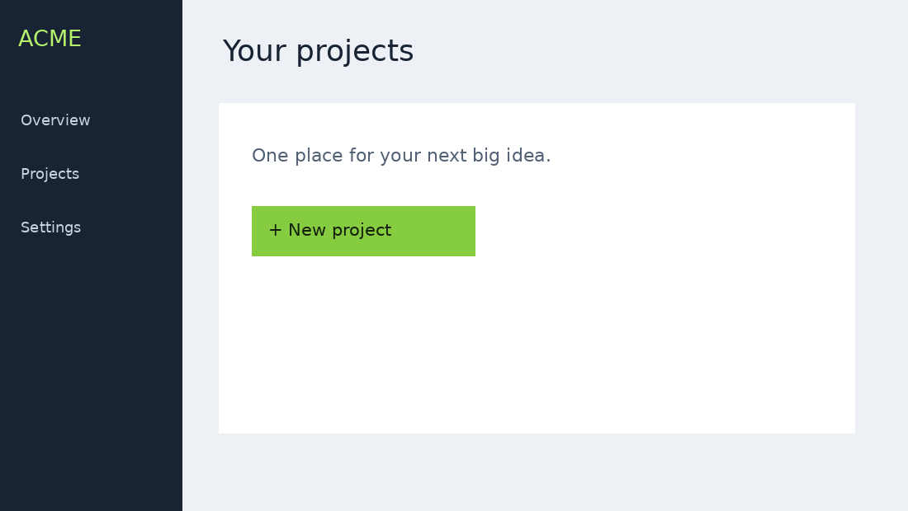

# Clicktrail

**Turn screenshots into a walkthrough people can actually click.**

Capture a screen → mark the target → export one offline HTML file.
No backend. No API key. No account. No analytics.



## Try it in 30 seconds

Open `editor.html` in Chrome or Edge, press **Load sample**, then **Export clickable HTML**. Open the downloaded file and click the green targets. This sample mode does not require installing the extension.

## Capture your own application

1. Download and unzip this repository.
2. Open `chrome://extensions` (Edge: `edge://extensions`). Enable **Developer mode**.
3. Choose **Load unpacked** and select the folder containing `manifest.json`.
4. Open a normal web page. Click the extension → **Capture this screen** (or press **Alt+Shift+S**).
5. Perform the action on the actual page. Capture the next screen. Repeat.
6. Open the extension → **Open walkthrough editor**. Click each screenshot to place its target, edit instructions, and reorder or delete steps.
7. Export the HTML and send it to someone. They need no extension and no network connection to play it.

**Capture before performing each action.** This version uses intentional screen captures, not automatic click recording. The exported file simulates the flow through screenshots; it does not run the original application.

## Why this exists

A video makes someone watch. A screenshot makes someone guess. A clickable walkthrough lets them try the flow. Useful for bug reproduction, onboarding, portfolios and showing a work-in-progress application without exposing a live account.

## Privacy and limitations

- Captures are stored in your browser's local extension storage, never sent by this extension to a server.
- Screenshots may include private information. Inspect every step before sharing. There is **no automatic redaction**.
- Only the visible viewport is captured, not the full scrolling page. One target per step.
- Supports normal HTTP/HTTPS tabs. Browser internal pages and extension pages cannot be captured through this tool.
- At most 30 steps; Chrome storage limits may be reached earlier on high-resolution screens. Export and clear when needed. Save errors are shown in the editor.
- Keep the editor closed while capturing; reopen after capturing to load the current steps. Editing and capture in parallel is not supported.
- Shortcut conflicts can be changed at `chrome://extensions/shortcuts`.
- Standalone sample mode uses localStorage and is intended for the small sample; use the extension for your own captures.
- Existing products such as Scribe, Tango and interactive demo platforms cover related workflows. This project focuses on a small, inspectable, local extension and a self-contained offline output. It does not claim to invent walkthroughs.

## Development

No build step or runtime dependencies. Node.js 18+ is needed only for tests:

```sh
npm test
```

`background.js`: capture and local persistence. `editor.js`: editing. `core.js`: standalone HTML generation. All extension scripts are local; no remote scripts or eval.

## Publish on GitHub

Create an empty public repository called `clicktrail`, then from this directory:

```sh
git init
git add .
git commit -m "feat: ship local screenshot-to-clickable-walkthrough extension"
git branch -M main
git remote add origin https://github.com/YOUR_USERNAME/clicktrail.git
git push -u origin main
```

Or upload this folder's contents through GitHub **Add file → Upload files**. Do not upload the outer ZIP as the repository's only file. Set the description to: `Capture screens. Mark clicks. Export an offline interactive walkthrough. No cloud required.`

## Contributing

Please open an issue describing a reproducible problem before large changes. Good first contributions: keyboard hotspot placement, local project import/export, localization, and user-controlled screenshot redaction. Do not add telemetry or upload captures by default.

MIT licensed. This is an initial release, not Chrome Web Store published software.

## Validation status

Automated tests cover local capture messaging with mocked browser APIs, restricted-page rejection, step limits, standalone player progression/completion/restart and safe text serialization. JavaScript syntax checks pass. Real Chrome extension capture and visual browser QA have not been performed in this environment; verify with a non-sensitive page after loading unpacked.

An example exported walkthrough is included at `docs/sample-walkthrough.html`.
